# Vision+ — Modélisation SysML d'une aide à la mobilité pour personnes malvoyantes

Projet d'ingénierie système réalisé à l'ENSISA (1A ASE, mars 2025) : modélisation **SysML** complète de **Vision+**, un dispositif porté (couronne ou casque léger) qui détecte les obstacles et les signale à l'utilisateur par des **vibrations haptiques**, en complément de la canne blanche.

📄 **Dossier complet (47 pages, 36 figures) : [docs/Vision-plus-SysML.pdf](docs/Vision-plus-SysML.pdf)**

**Projet de groupe** — Yasmine AIT OUAARAB, Muhammed CEREN, Daouda SYLLA. Chaque diagramme avait un responsable et un correcteur parmi les trois ; les figures ci-dessous sont celles dont j'étais **responsable**.

## Le système en bref

- Détection à 360° par capteurs **ultrasons** (2 cm – 4 m, ±3 mm) et **LiDAR**, mise à jour des mesures toutes les **100 ms**.
- Unité de traitement : microcontrôleur 32 bits à 48 MHz, basse consommation.
- Retour par moteurs vibrants **ERM** (130–250 Hz, jusqu'à 1,2 G) : plus l'obstacle est proche, plus la vibration est forte et rapide.
- Batterie Li-ion 1200 mAh, autonomie 8–10 h, recharge USB-C en ~30 min, extinction automatique des modules inutilisés.
- IHM minimale : un bouton et des bips de confirmation.

## Ma contribution (diagrammes dont j'étais responsable)

| Type | Figure | Sujet | Page |
|---|---|---|---|
| Cas d'utilisation | Fig. 3 (avec Yasmine) | Acteurs et cas d'utilisation | 7 |
| Exigences | Fig. 4 (avec Yasmine) | Exigences globales du système | 9 |
| Exigences | Fig. 5 | Sous-exigences — Communication | 10 |
| BDD | Fig. 11 | Système de perception de l'environnement | 17 |
| BDD | Fig. 12 | Gestion de l'énergie | 18 |
| BDD | Fig. 15 | Caméra | 21 |
| BDD | Fig. 16 | Reconnaissance faciale | 22 |
| IBD | Fig. 24 | Système de perception de l'environnement | 31 |
| IBD | Fig. 25 | Système de gestion de l'énergie | 32 |
| IBD | Fig. 26 | Caméra | 33 |
| Séquence | Fig. 31 | Caméra | 39 |
| Séquence | Fig. 32 | Reconnaissance vocale | 40 |

J'ai en outre **relu (rôle de correcteur)** 14 diagrammes de mes deux coéquipiers (figures 2, 8, 10, 13, 14, 17, 20, 22, 23, 27, 29, 34, 35, 36).

Le dossier couvre aussi les diagrammes de contexte, d'états, paramétriques et de ValueType, réalisés par mes coéquipiers.

## Aperçu

### Cas d'utilisation (Fig. 3)
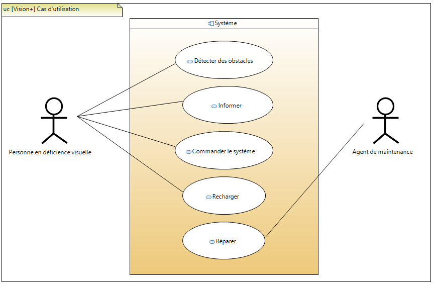

### Exigences (Fig. 4) et sous-exigences Communication (Fig. 5)
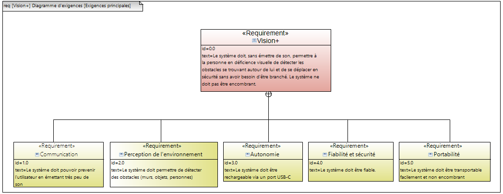
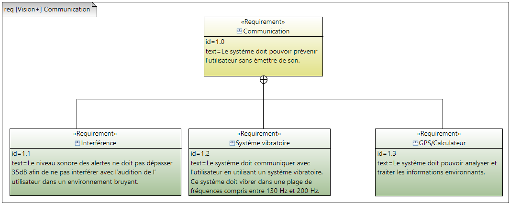

### Structure : diagrammes de définition de blocs
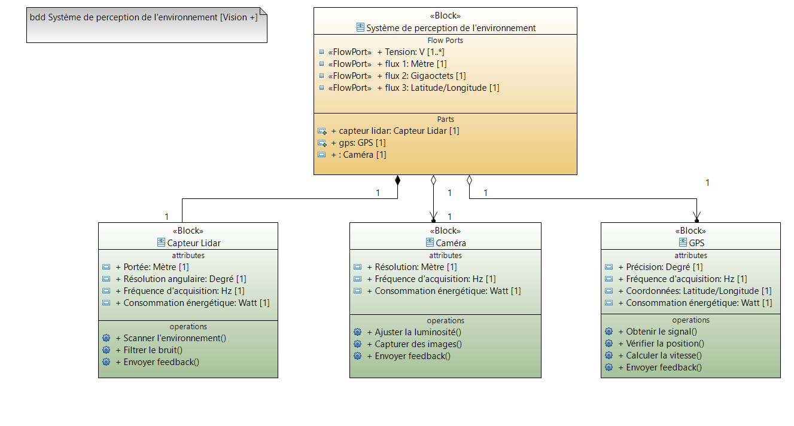
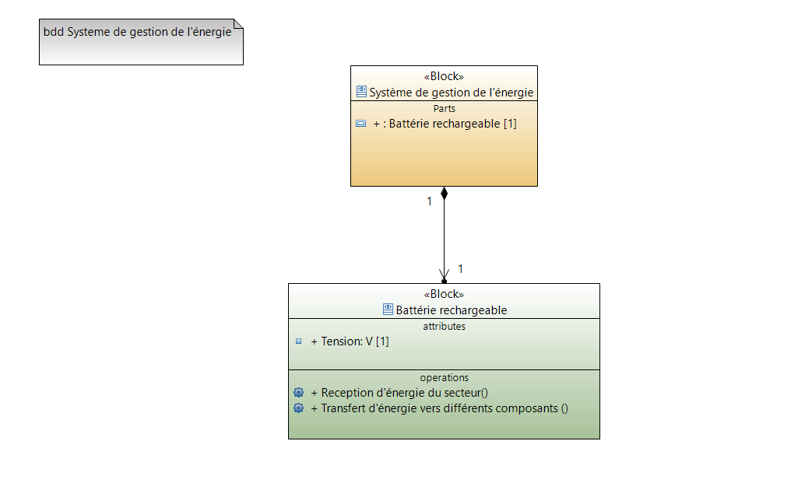
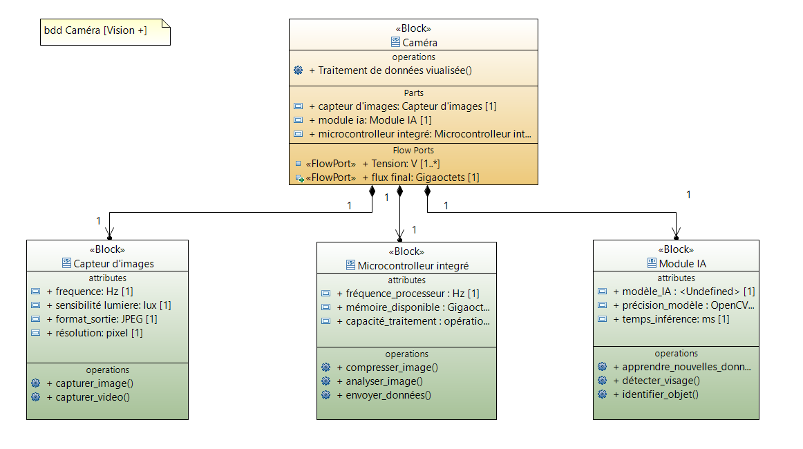
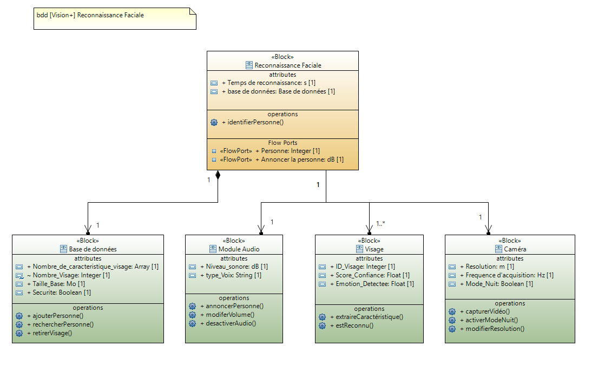

### Interconnexions : diagrammes de blocs internes
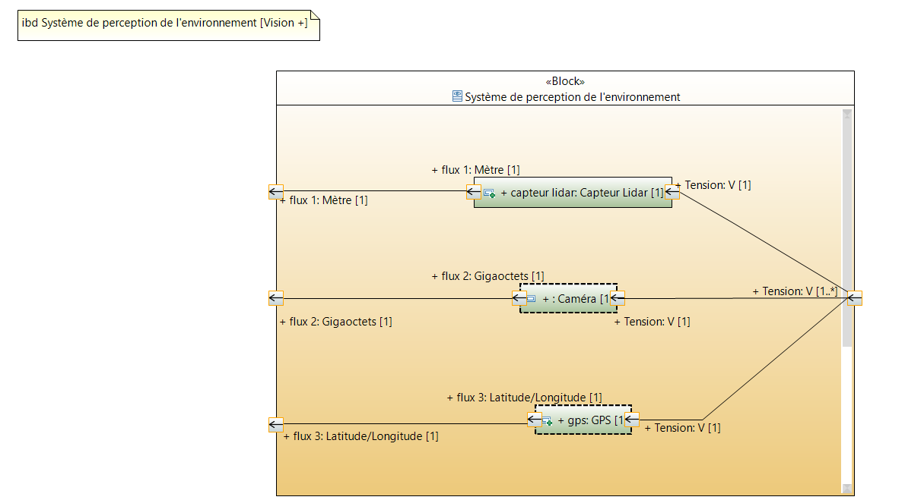
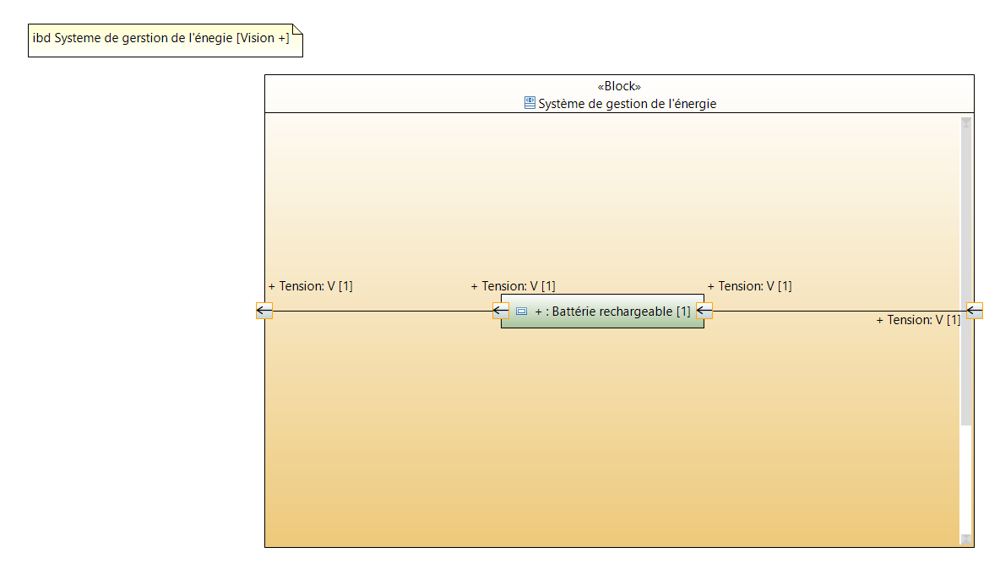
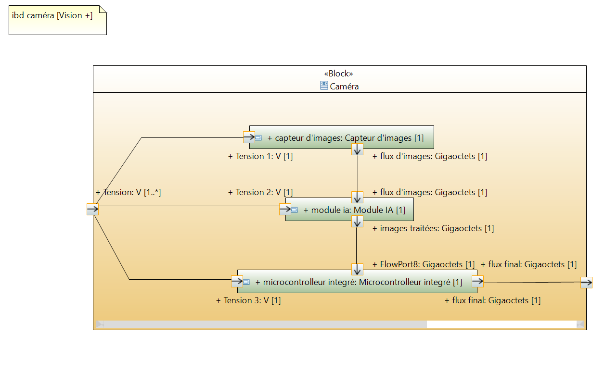

### Comportement : diagrammes de séquence
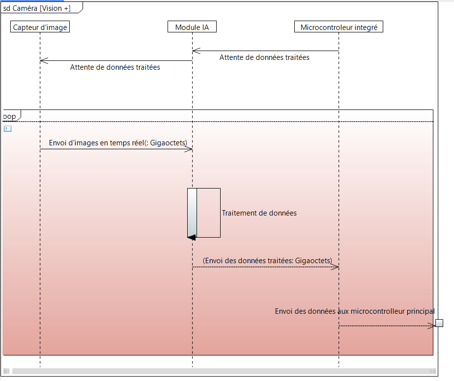
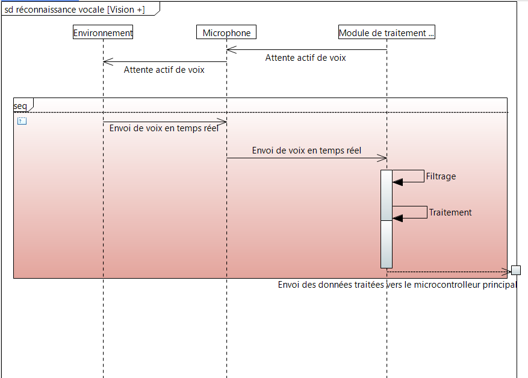

## Démarche

Exigences → cas d'utilisation → décomposition structurelle (BDD) → connexions et flux (IBD) → scénarios dynamiques (séquence), avec relecture croisée systématique entre les trois membres du groupe.

## Contenu du dépôt

```
docs/Vision-plus-SysML.pdf   dossier complet
images/                      diagrammes dont je suis responsable (PNG)
```

## Droits

Travail pédagogique de groupe. © 2025 Y. Ait Ouaarab, M. Ceren, D. Sylla — tous droits réservés ; aucune licence d'utilisation n'est accordée sans l'accord des auteurs.
